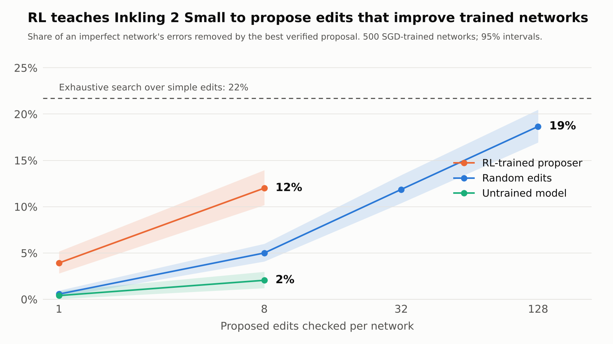

# WeightGym

**Training an open model to repair neural networks by reading their raw weights.**

WeightGym is a fast simulator of small ReLU networks with planted faults. A model is shown a network's
weights as plain text and one line describing what the network should compute, and must answer with a
tiny edit (at most 3 operations, each touching one row, one column or one scalar) that makes it work
again. Edits are scored only by how the edited network behaves.

We used it to post-train **Inkling 2 Small** on Thinking Machines' **Tinker** API (LoRA: a supervised
warm-start, then policy-gradient RL with the tinker-cookbook loop) and measured the result on held-out
networks.


## Result

Repair rate with **no reasoning tokens** (the model must answer at once; ~40 output tokens), on frozen
test splits of 500 networks each. A network counts as repaired when the edit restores at least 95% of
the accuracy the fault destroyed. 95% bootstrap intervals in brackets.

| Test split | Untrained | Supervised stage | + RL (final) |
|---|---|---|---|
| **In-distribution (primary metric)** | 0.2% | 70.4% | **76.5%** [72.5, 80.6] |
| Larger networks than any in training | 0.0% | 52.2% | 60.6% [55.8, 65.1] |
| Function families never trained on | 0.7% | 44.2% | 53.6% [48.6, 58.3] |
| Fault types never trained on | 0.5% | 20.9% | 22.9% [18.9, 27.0] |
| SGD-trained networks (training used only hand-built ones) | 0.3% | 12.9% | 13.9% [10.4, 17.4] |
| Networks trained by an independent library (scikit-learn, L-BFGS) | 1.7% | — | 9.4% [6.8, 12.3] |

Paired difference, final vs untrained, on the primary split: **+76.3 points** [+72.3, +80.3].
Healthy control networks correctly left unedited: 15% untrained, 86% after the supervised stage, 99% after RL.

For scale, on the same in-distribution test networks:

| Reference | Repair rate | Tokens generated per network |
|---|---|---|
| Untrained Inkling 2 Small, free to reason (20K-token cap, first 100 networks) | 77.3% [68.2, 85.2] | ~10,800 |
| **Trained Inkling 2 Small, no reasoning** | **76.5%** | **~40** |
| GPT-6.1 Sol, lowest reasoning setting (n=86)\* | 90.8% | ~200 (171 reasoning) |
| GPT-6 Astra, lowest reasoning setting (n=95)\* | 96.4% | ~140 (113 reasoning) |
| GPT-6.1 Sol / GPT-6 Astra, default reasoning (n=54 each)\* | 100% / 100% | ~450 / ~400 |
| Brute-force search over single sign flips and swaps, **using forward passes** | 65.2% | — |
| Gradient descent on half of the inputs (ignores the edit budget) | 61.4% | — |
| Statistics-only heuristic (most unusual row / column / scalar) | 4.0% | — |
| Random valid edit / never edit | 0.7% / 0% | — |

\* Frontier models were run through OpenRouter on the same prompts; the account ran out of credit before
100 networks, so these are partial samples. Their APIs do not allow reasoning to be switched off entirely.

### What this does and does not show

- **An open-weights model can be trained to do weight-space repair.** Before training, Inkling 2 Small
  can do the task only by reasoning for about 10,800 tokens, and still runs out of room on 22% of
  networks. After post-training it matches that accuracy in ~40 tokens, with no reasoning, no tools and
  no forward passes. As far as we know this is the first *trained* weight-space programmer working from
  weights as text; published results so far use closed frontier models off the shelf.
- **It carries over to unseen function families (54%) and larger networks (61%)**, so it is not simply
  memorising the training circuits. A statistics-only heuristic repairs 2-8% on these splits.
- **It does not carry over to networks produced by an optimiser: 14% on our own SGD-trained networks
  and 9% on networks fitted by scikit-learn** (`data/test_external.jsonl`, added after training; the
  supervised checkpoint no longer existed, hence the dash). Training saw only hand-built circuits hidden
  behind symmetries. This is the most important limitation. No public benchmark of small ReLU networks
  with exactly checkable tasks was found to test on; the nearest, WSPBench, would need conversion.
- **Frontier models are far ahead.** GPT-6 Astra and GPT-6.1 Sol repair 91-100% of the same networks
  with a few hundred reasoning tokens, and about 90% of the SGD-trained ones. This gym, at this size, is
  near ceiling for them. The open/closed gap on this skill is large; post-training closes part of it.
- **Most of the gain is supervised.** The warm-start trains on synthetic faults whose inverse edit is
  known because we planted it. RL on top added 6 points in-distribution and 8-9 points on unseen
  families and larger networks, and taught the model to leave healthy networks alone (86% -> 99%).
- **Pure RL from the base model failed.** At all but the lowest learning rate it learned the answer
  format in 1-2 steps and then collapsed to always answering "no edit": when ~2% of guesses succeed,
  doing nothing beats guessing.
- **The adapter is a specialist.** Asked to reason, the trained model does not: it still answers in ~36
  tokens. Nothing here shows it became a better weight-space *reasoner*.
- After RL, sampled answers (temperature 1.0, the pre-registered setting) and greedy answers score the
  same on validation (81.8%); midway through the supervised stage greedy was 19 points higher. Part of
  what RL does is concentrate the policy on its best guess. We could not measure the final supervised
  checkpoint's greedy score before it was pruned, so RL's gain cannot be split into "sharper" and "better".

### Breakdown of the final model on the primary split

| Prompt variant | Repair rate | | Fault type | Repair rate |
|---|---|---|---|---|
| Weights only | 67.9% | | Swapped output units | 92.9% |
| Weights + up to 8 failing inputs | 86.4% | | Sign flip, incoming row | 86.2% |
| | | | Sign flip, outgoing column | 81.9% |
| | | | Shifted bias | 80.0% |
| | | | One corrupted weight | 78.9% |
| | | | Mis-scaled outgoing column | 77.8% |
| | | | Swapped outgoing columns | 54.1% |

## The gym

"Weight-space programming" is the observation, from Takehi, Teoh, Zhang and Khattab's November 2026
post [*Sparks of Weight-Space Programming*](https://rikiyat.github.io/blog/weight-space-programming/),
that a frontier LLM can read a small network's weights as text and write better ones, with no gradients
and, in their small-network experiments, no tools. Follow-ups asked how much of that is real reading:
[Beaker](https://www.withbeaker.ai/blog/weight-space-programming) showed the headline edit to a real
0.8B LLM is matched by banning one token, and others showed some "reads" survive only until the network
is permuted or rescaled. WeightGym is built around those objections:

- **Symmetries are built in.** Every training network is a hand-compiled circuit hidden behind neuron
  permutation, per-neuron rescaling, neuron splitting, distractor neurons (dead neurons, exactly
  cancelling pairs), weight noise and rounding. There is no canonical layout to memorise.
- **Faults are invisible to marginal statistics** where possible: sign flips and swaps leave the multiset
  of weight magnitudes unchanged; scale faults stay inside the range the rescaling already produces.
- **Clean controls.** About 18% of networks have no fault; the right answer is the empty edit `[]`, and
  editing a healthy network is penalised.
- **Behavioural scoring.** `recovery = (acc_after - acc_faulty) / (acc_clean - acc_faulty)` on the
  task's scoring inputs (exhaustive when the input space is small). Any functionally equivalent fix
  counts; nothing is matched against the planted fault.
- **Trivial baselines are in the table.**

**Networks.** 11 function families built from interpretable ReLU gadgets: boolean formulas, parity,
thresholds / k-of-n, comparisons, min / max / sort, arithmetic (|a-b|, clip, saturation, dead zone),
argmax over group sums, counting, pairwise equality / Hamming distance, multiplexers and interval
membership; 1-2 hidden layers, roughly 20-700 weights. A second source trains networks of the same size
by gradient descent on the same functions.
**Faults.** 9 types: sign flip of a neuron's outgoing column or incoming row, swapped outgoing columns,
mis-scaled outgoing column, shifted bias, one corrupted weight, swapped output units, mis-scaled incoming
row, and a shared spurious direction added to the outgoing weights of 2-3 neurons.
**Prompts.** Two variants, weights only and weights plus up to 8 failing inputs. The answer is a JSON
list in a strict DSL (`scale`, `swap`, `set`, `add`); see `weightgym/edits.py`.

| Split (`data/`, frozen before training) | What it tests |
|---|---|
| `train` | 9 families x 7 fault types, small and medium networks (deterministic stream) |
| `val` | same distribution; used only to pick checkpoints |
| `test_id` | same distribution; **primary metric** |
| `test_families` | 2 held-out families (multiplexer, interval membership) |
| `test_faults` | 2 held-out fault types (mis-scaled incoming row, spurious direction) |
| `test_larger` | networks larger than any seen in training |
| `test_trained` | SGD-trained networks; repair training never sees one |
| `test_external` | networks fitted by scikit-learn (a different optimiser and initialisation), then faulted |

## Training on Tinker

- **Model:** `thinkingmachines/Inkling-2-Small`, LoRA rank 32, renderer `tml_v0`, thinking effort 0.0,
  temperature 1.0, 256-token cap, prompt ending in an instruction to answer immediately.
- **Supervised warm-start:** 300 steps x 64 networks (19,200 networks), lr 3e-4 decaying to 6e-5,
  target = the planted fault's inverse edit. Validation repair went 1% -> 75%.
- **RL:** tinker-cookbook policy-gradient loop (`importance_sampling` loss, rewards centred within each
  group of 8 samples of the same network), 60 steps x 64 networks, lr 2e-5, reward as above (+1 for
  `[]` on a healthy network, a penalty for editing one, -1 for an invalid answer). Validation 75% -> 82%.
- **Checkpoint selection** by validation repair rate only; each test split evaluated once per arm.
- **Cost:** about $90 of Tinker usage for everything in this section, including sweeps and evaluations;
  about $135 for the whole project so far (`python -m weightgym.cost`).

## Limitations

- Tiny networks (tens to hundreds of weights), single planted faults, functions with a one-line formula.
- Search with forward passes and gradient descent both repair 60-70% of these networks; the point is
  that a language model can learn to do it from the weights alone, not that this beats either.
- Poor transfer to SGD-trained networks (14%) and to unseen fault types (23%).
- Frontier closed models solve the gym almost completely; it does not discriminate between them.
- One training seed. No test on a real LLM.
- Synthetic data: every network and fault comes from this repository's generator.

## Second result: RL alone teaches it to improve imperfect trained networks

The repair result leans on a supervised stage and on planted faults. This experiment removes both.

- **Networks:** small MLPs trained by gradient descent with a weak recipe, so they only partly learned
  their function (60-93% accurate, about 79% on average). Nothing is planted; nobody knows a correct edit.
- **Loop:** the model proposes an edit (same DSL, at most 3 operations); the gym checks it with forward
  passes and keeps it only if the network gets more accurate. A rejected proposal costs nothing.
- **Training:** pure RL from the *untouched* base model with the tinker-cookbook loop. No supervised
  stage and no labels of any kind; the reward is the share of the network's errors a proposal removes.
  80 steps of 32 networks x 16 proposals, rank-16 LoRA, about $36.



Share of errors removed by the best verified proposal, 500 held-out imperfect networks, no reasoning
tokens (`results/table_improve.csv`):

| Proposer | 1 proposal | 8 proposals | Networks improved (8) |
|---|---|---|---|
| Untrained Inkling 2 Small | +0.4% | +2.1% | 5% |
| Random valid edits | +0.6% | +5.0% [4.1, 6.0] | 20% |
| **RL-trained Inkling 2 Small** | **+3.9%** | **+12.0%** [10.2, 14.0] | **31%** |
| Random edits, 32 / 128 proposals | | +11.9% / +18.7% | 36% / 54% |
| Exhaustive search over simple edits | | +21.7% | 57% |

- Eight proposals from the trained model do what about 32 random ones do; one trained proposal is worth
  roughly six random ones.
- On function families never used in training: +7.9% [6.4, 9.6] against +5.0% for random edits.
- Applied for three rounds, re-reading the edited network each time (24 checks): +18.7% [16.3, 21.3]
  against +11.0% for random proposals and +22.0% for random search with four times as many checks. This
  multi-round protocol was added after the single-round result and is not pre-registered.
- The proposer answers almost entirely with direct overwrites of weights and biases, three at a time,
  and does as well from the weights alone as when failing inputs are shown.

What this shows: an RL gym with a verifier can, on its own, make a model better at proposing weight
edits that improve genuinely trained networks. What it does not show: large gains. The loop removes a
tenth to a fifth of the errors of networks with a few dozen weights, exhaustive search still does better
when forward passes are free, and gradient descent does better than all of it. A warm start that imitated
the edits found by search did *not* help (it learned to answer "no edit"), and was dropped.

## Benchmark your own model

Any OpenAI-compatible endpoint can be scored on the same frozen splits and prompts:

```bash
export WEIGHTGYM_BASE_URL=https://your-endpoint/v1 WEIGHTGYM_API_KEY=...
uv run python -m weightgym.frontier_eval --model your-model --mode direct    --arm mymodel_direct    --split test_id --n 500
uv run python -m weightgym.frontier_eval --model your-model --mode reasoning --arm mymodel_reasoning --split test_trained --n 500
uv run python -m weightgym.final_eval --tables-only        # adds your rows to results/table_main.csv
```

Tinker models and checkpoints go through `weightgym.final_eval` (repair) and
`python -m weightgym.imperfect eval <name> <tinker://sampler | base> 8 test_imperfect` (improve loop).

## Other tasks in the repository

- `weightgym/imperfect.py`: the improve task above, including the search teacher, the loop baselines and
  the multi-round loop.
- `weightgym/decompile.py`: reading a network's weights and writing the program it computes as an
  expression that is executed and compared with the network on every input. Tested; not trained here.
- `weightgym/audit.py`: backdoor auditing. Networks that pass 32 random tests but contain a planted
  trigger (hand-inserted, or learned from poisoned training data); the answer is an edit that removes it.
  Generator, tests and frozen splits (`data/*audit*.jsonl`) are included; no model was trained or
  evaluated on it here.
- `weightgym/reprogram.py`: editing a correct network so that it computes a related target function.
  Experimental: the generator is written but has no tests or frozen splits yet.

## Reproduce

```bash
uv sync
uv run pytest -q                                   # gym invariants: symmetries, faults, DSL, rewards, determinism
uv run python -m weightgym.splits                  # regenerates data/ deterministically
export TINKER_API_KEY=...                          # never committed
uv run python -m weightgym.tinker_train sft --log-path runs/sft --lr 3e-4 --decay 0.8 --steps 300 --batch-size 64
uv run python -m weightgym.rl_chunks --log-path runs/rl --load tinker://<sft state> --init-sampler tinker://<sft sampler> \
    --init-val 0.754 --lr 2e-5 --chunks 6 --chunk-steps 10 --group-size 8 --groups-per-batch 64
uv run python -m weightgym.final_eval --arm untrained --arm sft_rl=tinker://<sampler> --baselines --thinking-ref 100
uv run python -m weightgym.plot --arms untrained,sft,sft_rl --labels "Untrained,Supervised stage,+ RL (final)"
uv run python -m weightgym.cost
```

`rl_chunks.py` exists because Tinker's free checkpoint storage holds 100 GB and one Inkling 2 Small
training state is 50 GB; it runs the cookbook RL loop in short chunks and keeps only the newest state
and the best sampler weights. Every number above comes from a JSONL log under `runs/`; `NOTES.md`
records the pre-registration, every deviation from the original plan, and the surprises along the way.

## Credits and related work

- Takehi, Teoh, Zhang, Khattab, *Sparks of Weight-Space Programming* (2026) and its released logs.
- Beaker, *Weight-space programming* (2026), for the trivial-baseline discipline.
- Langosco et al., *Towards Meta-Models for Automated Interpretability*, and Weight Oracles
  (arXiv 2610.07334): trained weight readers that take weights as numbers rather than text.
- Cha et al. (arXiv 2611.05798) for auditing weight readers with function-preserving symmetries;
  WSPBench for a planted-fault repair benchmark.
- Thinking Machines' Tinker and tinker-cookbook, whose RL loop this uses.
