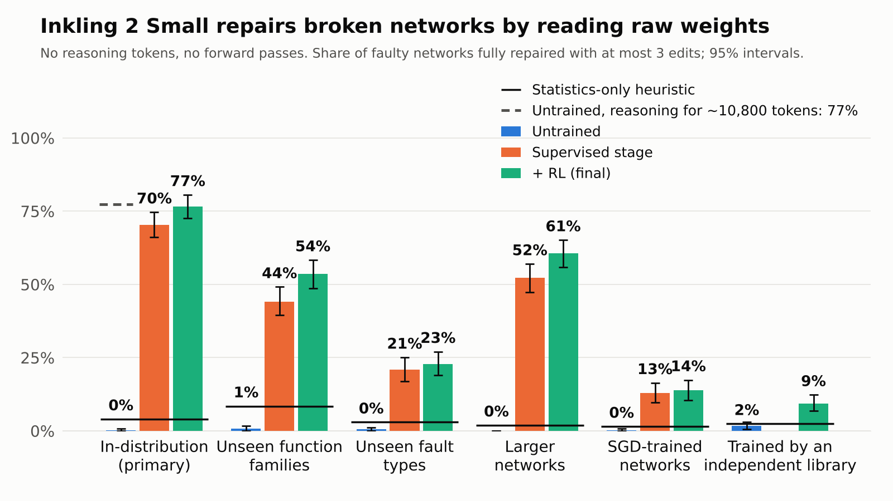

# WSP-Gym

**Training an open model to repair neural networks by reading their raw weights.**

WSP-Gym is a fast simulator of small ReLU networks with planted faults (a gym for weight-space programming;
the Python package is `weightgym`). A model is shown a network's
weights as plain text and one line describing what the network should compute, and must answer with a
tiny edit (at most 3 operations, each touching one row, one column or one scalar) that makes it work
again. Edits are scored only by how the edited network behaves.

We used it to post-train **Inkling 2 Small** on Thinking Machines' **Tinker** API (LoRA: supervised
training on synthetic faults, then policy-gradient RL with the tinker-cookbook loop) and measured the
result on held-out networks. Four results:

1. **Repair at a glance.** With no reasoning tokens, the share of broken networks it fixes goes from
   0.2% to 82.9%. The untrained model, allowed about 10,600 reasoning tokens per network, fixes 75.6%
   of the same networks. The same trained model fixes 67% of networks made by gradient descent and 51%
   of networks from an optimiser it never saw.
2. **RL alone, no labels.** Pure RL from the untouched base model teaches it to propose edits that
   improve genuinely imperfect trained networks: 8 proposals remove 12% of a network's errors, against
   5% for random edits and 2% for the untrained model.
3. **Real data, honestly.** On small networks trained on real tabular datasets it never saw, one
   proposal from an RL-trained model is worth about eight random ones, but with eight proposals the edge
   over random search is small. On 13 public image classifiers, editing the final layer improved none
   of the well-trained ones.

4. **A real LLM.** Shown one layer of Qwen3.5-0.8B as a small table read from its weights, Inkling 2 Small
   proposes an edit that takes MATH-500 from 8% to 38%, level with the published edit found with closed
   frontier models. Proposers RL-trained on small networks give that edit in one short answer.

Frontier closed models still do much better on this gym; see the comparison below.



*Chart: the untrained model and the final trained model. The earlier, smaller models are in
`results/repair_rate_first_models.png` and `results/repair_rate_stages.png`.*

## Result

Repair rate with **no reasoning tokens** (the model must answer at once; ~38 output tokens), on frozen
test splits of 500 networks each. A network counts as repaired when the edit restores at least 95% of
the accuracy the fault destroyed. 95% bootstrap intervals in brackets. One model, one LoRA adapter, for
every row.

| Test split | Untrained | Trained (final) | Healthy networks left alone |
|---|---|---|---|
| **In-distribution (primary metric)** | 0.2% | **82.9%** [79.4, 86.5] | 100% |
| Larger networks than any in training | 0.0% | **70.0%** [65.6, 74.3] | 94% |
| Function families never trained on | 0.7% | **58.6%** [53.6, 63.3] | 71% |
| Fault types never trained on | 0.5% | **19.9%** [16.2, 23.8] | 99% |
| Networks made by gradient descent (our trainer) | 0.2% | **66.7%** [62.0, 71.2] | 95% |
| Networks fitted by scikit-learn (an optimiser never used in training) | 1.7% | **51.3%** [46.5, 56.4] | 72% |

Paired difference, final vs untrained, on the primary split: **+82.7 points** [+79.1, +86.3]. The last
column is the share of fault-free control networks for which the model correctly answers "no edit".

For scale, on the same in-distribution test networks:

| Reference | Repair rate | Tokens generated per network |
|---|---|---|
| Untrained Inkling 2 Small, free to reason (20K-token cap) | 75.6% [71.3, 79.6] | ~10,600 |
| **Trained Inkling 2 Small, no reasoning** | **82.9%** [79.4, 86.5] | **~38** |
| GPT-6.1 Sol, lowest reasoning setting (n=86)\* | 90.8% | ~200 (171 reasoning) |
| GPT-6 Astra, lowest reasoning setting (n=95)\* | 96.4% | ~140 (113 reasoning) |
| GPT-6.1 Sol / GPT-6 Astra, default reasoning (n=54 each)\* | 100% / 100% | ~450 / ~400 |
| Brute-force search over single sign flips and swaps, **using forward passes** | 65.2% | — |
| Gradient descent on half of the inputs (ignores the edit budget) | 61.4% | — |
| Statistics-only heuristic (most unusual row / column / scalar) | 4.0% | — |
| Random valid edit / never edit | 0.7% / 0% | — |

**Trained without reasoning against untrained with reasoning,** paired on the same 422 faulty networks:
+7.3 points [+2.4, +12.3] (`results/table_vs_reasoning.csv`). The untrained model runs out of its
20,000-token allowance on 22% of networks.

\* Frontier models were run through OpenRouter on the same prompts; the account ran out of credit before
100 networks, so these are partial samples. Their APIs do not allow reasoning to be switched off entirely.

### How it got there

Four earlier checkpoints on the same frozen test splits, each evaluated once:

| Model | Networks in supervised training | In-distribution | Larger | Unseen families | Unseen faults | Gradient-made | scikit-learn |
|---|---|---|---|---|---|---|---|
| First model, supervised | 19,200 hand-built | 70.4% | 52.2% | 44.2% | 20.9% | 12.9% | — |
| First model + RL | same | 76.5% | 60.6% | 53.6% | 22.9% | 13.9% | 9.4% |
| Mixed sources, supervised | 9,600 hand-built + 9,600 gradient-made | 57.1% | 39.2% | 40.7% | 14.0% | 46.2% | 36.4% |
| Scale-up, supervised | 28,800 + 28,800 | 80.3% | 65.4% | 55.6% | 19.9% | 61.8% | 50.1% |
| **Scale-up + RL (final)** | same | **82.9%** | **70.0%** | **58.6%** | 19.9% | **66.7%** | **51.3%** |

- **Training data did most of the work.** The same supervised recipe on three times the data moved the
  mixed-source model from 57% to 80% in-distribution, from 46% to 62% on gradient-made networks and
  from 36% to 50% on the scikit-learn ones.
- **Networks made by gradient descent need to be in the training mix.** Trained on hand-built circuits
  only, the first model repaired 14% of them; with them in the mix the final model repairs 67%, and 51%
  of networks from an optimiser it never saw.
- **RL on top of the scale-up added a little repair and a lot of restraint.** Paired on the same
  networks, RL minus supervised is +2.6 points in-distribution [-0.5, +5.9], +4.6 on larger networks
  [+0.7, +8.4] and +5.0 on gradient-made ones [+1.2, +8.7]; nothing on unseen fault types. Pooled over
  the six splits it is +2.7 [+1.2, +4.2] (a post-hoc summary; `results/table_rl_vs_sft.csv`). The clearer effect is on healthy
  networks: the share correctly left unedited rose from 79% to 94% on larger networks, 58% to 71% on
  unseen families and 86% to 95% on gradient-made ones. On the first, smaller model RL added 6 points.
- **RL sharpened the model's answers; it did not improve its best guess.** On validation, greedy
  decoding scored 90.7% (hand-built) and 75.7% (gradient-made) before RL and 89.8% and 73.4% after,
  while answers sampled at temperature 1.0 went from 83.5% and 69.2% to 88.1% and 72.2%.
- The prediction made before the run was "mid-80s" in-distribution; it landed at 82.9%.

*Secondary, labelled as such before the run:* with greedy decoding instead of sampling at temperature
1.0, the final model scores 84.6% [81.3, 87.9] in-distribution, 73.1% on larger networks, 68.2% on
gradient-made networks and 54.9% on the scikit-learn ones. All headline numbers in this README use the
pre-registered temperature of 1.0.

### With a verifier: eight proposals

A different regime, kept apart from the headline because it uses forward passes. The final model
samples 8 answers per faulty network; a verifier that knows the spec runs each edited network and keeps
the first one that repairs it (`weightgym/verify_eval.py`, `results/table_verify.csv`).

| Share of faulty networks fixed | In-distribution | Gradient-made | scikit-learn |
|---|---|---|---|
| Final model, one answer (the headline regime) | 82.9% | 66.7% | 51.3% |
| **Final model, best of 8 verified answers** | **90.5%** [87.7, 93.1] | **77.2%** [73.0, 81.4] | **65.1%** [60.5, 69.6] |
| 8 random valid edits, verified | 7.3% | 8.2% | 10.4% |
| Brute-force search over single sign flips and swaps | 65.2% | 63.5% | 64.8% |
| Gradient descent on half of the inputs (no edit budget) | 61.4% | 71.5% | 74.9% |

Eight verified proposals beat both forward-pass baselines in-distribution and on gradient-made networks.
On the scikit-learn networks they only match the simple search and stay below gradient descent. The 8
samples contain 2.4 to 3.4 distinct answers on average, so most of the gain comes from the second and
third guess.

### What this does and does not show

- **An open-weights model can be trained to do weight-space repair, and to do it without reasoning.**
  Before training, Inkling 2 Small can do the task only by reasoning for about 10,600 tokens, and still
  runs out of room on 22% of networks. After post-training it fixes more of the same networks (+7.3
  points, interval above) in ~38 tokens, with no reasoning, no tools and no forward passes. As far as
  we know this is the first *trained* weight-space programmer working from weights as text; published
  results so far use closed frontier models off the shelf.
- **It carries over to unseen function families (59%) and larger networks (70%)**, so it is not simply
  memorising the training circuits. A statistics-only heuristic repairs 2-8% on these splits.
- **It carries over to an optimiser it never saw (51% on scikit-learn networks), but loses ground
  there**: 67% on networks from our own trainer, and it wrongly edits 28% of healthy scikit-learn
  networks. Forward-pass search repairs 65% of the scikit-learn networks and gradient descent 75%. No
  public benchmark of small ReLU networks with exactly checkable tasks was found to test on; the
  nearest, WSPBench, would need conversion.
- **Fault types it never saw remain the weak row (20%)** and neither more data nor RL moved it.
- **Frontier models are far ahead.** GPT-6 Astra and GPT-6.1 Sol repair 91-100% of the same networks
  with a few hundred reasoning tokens, and about 90% of the gradient-made ones. This gym, at this size,
  is near ceiling for them. The open/closed gap on this skill is large; post-training closes part of it.
- **Most of the gain is supervised.** The supervised stage trains on synthetic faults whose inverse
  edit is known because we planted it. RL's contribution is described above.
- **Pure RL from the base model failed on this task.** At all but the lowest learning rate it learned
  the answer format in 1-2 steps and then collapsed to always answering "no edit": when ~2% of guesses
  succeed, doing nothing beats guessing. (It works in the propose-and-verify setting of the second
  result below, where a wrong proposal is simply rejected.)
- **The adapter is a specialist.** Asked to reason, the first trained model did not: it still answered
  in ~36 tokens. Nothing here shows it became a better weight-space *reasoner*.

### Breakdown of the final model on the primary split

| Prompt variant | Repair rate | | Fault type | Repair rate |
|---|---|---|---|---|
| Weights only | 78.1% | | Sign flip, outgoing column | 95.8% |
| Weights + up to 8 failing inputs | 88.4% | | Sign flip, incoming row | 94.8% |
| | | | Swapped output units (14 networks) | 85.7% |
| | | | Shifted bias | 81.4% |
| | | | One corrupted weight | 78.9% |
| | | | Mis-scaled outgoing column | 76.2% |
| | | | Swapped outgoing columns | 71.6% |

## The gym

"Weight-space programming" is the observation, from Takehi, Teoh, Zhang and Khattab's November 2026
post [*Sparks of Weight-Space Programming*](https://rikiyat.github.io/blog/weight-space-programming/),
that a frontier LLM can read a small network's weights as text and write better ones, with no gradients
and, in their small-network experiments, no tools. Follow-ups asked how much of that is real reading:
[Beaker](https://www.withbeaker.ai/blog/weight-space-programming) showed the headline edit to a real
0.8B LLM is matched by banning one token, and others showed some "reads" survive only until the network
is permuted or rescaled. WSP-Gym is built around those objections:

- **Symmetries are built in.** Every training network is a hand-compiled circuit hidden behind neuron
  permutation, per-neuron rescaling, neuron splitting, distractor neurons (dead neurons, exactly
  cancelling pairs), weight noise and rounding. There is no canonical layout to memorise.
- **Faults are invisible to marginal statistics** where possible: sign flips and swaps leave the multiset
  of weight magnitudes unchanged; scale faults stay inside the range the rescaling already produces.
- **Clean controls.** About 18% of networks have no fault; the right answer is the empty edit `[]`, and
  editing a healthy network is penalised.
- **Behavioural scoring.** `recovery = (acc_after - acc_faulty) / (acc_clean - acc_faulty)` on the
  task's scoring inputs (exhaustive when the input space is small). Any functionally equivalent fix
  counts; nothing is matched against the planted fault.
- **Trivial baselines are in the table.**

**Networks.** 11 function families built from interpretable ReLU gadgets: boolean formulas, parity,
thresholds / k-of-n, comparisons, min / max / sort, arithmetic (|a-b|, clip, saturation, dead zone),
argmax over group sums, counting, pairwise equality / Hamming distance, multiplexers and interval
membership; 1-2 hidden layers, roughly 20-700 weights. A second source trains networks of the same size
by gradient descent on the same functions.
**Faults.** 9 types: sign flip of a neuron's outgoing column or incoming row, swapped outgoing columns,
mis-scaled outgoing column, shifted bias, one corrupted weight, swapped output units, mis-scaled incoming
row, and a shared spurious direction added to the outgoing weights of 2-3 neurons.
**Prompts.** Two variants, weights only and weights plus up to 8 failing inputs. The answer is a JSON
list in a strict DSL (`scale`, `swap`, `set`, `add`); see `weightgym/edits.py`.

| Split (`data/`, frozen before training) | What it tests |
|---|---|
| `train` | 9 families x 7 fault types, small and medium networks (deterministic stream) |
| `val` | same distribution; used only to pick checkpoints |
| `test_id` | same distribution; **primary metric** |
| `test_families` | 2 held-out families (multiplexer, interval membership) |
| `test_faults` | 2 held-out fault types (mis-scaled incoming row, spurious direction) |
| `test_larger` | networks larger than any seen in training |
| `test_trained` | SGD-trained networks; repair training never sees one |
| `test_external` | networks fitted by scikit-learn (a different optimiser and initialisation), then faulted |

## Training on Tinker

- **Model:** `thinkingmachines/Inkling-2-Small`, LoRA, renderer `tml_v0`, thinking effort 0.0,
  temperature 1.0, 256-token cap, prompt ending in an instruction to answer immediately.
- **Final model, supervised stage:** rank-16 LoRA from the base model, 900 steps x 64 networks (57,600
  networks; every other one made by gradient descent, `--mix repair,repair_trained`), lr 3e-4 decaying
  linearly to 6e-5, target = the planted fault's inverse edit. Validation repair went from 1% to 83.5%
  on hand-built networks and 69.2% on gradient-made ones.
- **Final model, RL stage:** tinker-cookbook policy-gradient loop (`importance_sampling` loss, rewards
  centred within each group of 8 samples of the same network), 100 steps x 64 networks, half of them
  gradient-made, lr 2e-5, reward as above (+1 for `[]` on a healthy network, a penalty for editing one,
  -1 for an invalid answer). Run as 10 chunks of 10 steps with validation after each.
- **Checkpoint selection** by the mean of the two validation repair rates (300 hand-built and 200
  gradient-made networks): 0.764 after the supervised stage, 0.802 for the selected RL checkpoint
  (chunk 5 of 0-9). The stopping rule was fixed before RL started, and each test split was evaluated
  once per checkpoint.
- **Earlier models:** the first model is rank 32, 300 supervised steps x 64 hand-built networks and 60
  RL steps; the mixed-source model is the same supervised recipe on 9,600 + 9,600 networks with no RL.
- **Cost:** about $174 of Tinker usage for the final model (supervised stage $123.50, RL $39.69, the rest
  evaluation), and about $418 for the whole project including the earlier models, the improve-loop
  experiments, sweeps and every evaluation. Estimated from token counts at list prices
  (`python -m weightgym.cost`, `runs/cost_tally.json`).
- **Adapters kept on Tinker** (LoRA sampler weights): the final repair model, the first repair model,
  the mixed-source model and the two RL-trained proposers (formula tasks, real data).

## Limitations

- Tiny networks (tens to hundreds of weights), single planted faults, functions with a one-line formula.
- Search with forward passes and gradient descent both repair 60-75% of these networks; the point is
  that a language model can learn to do it from the weights alone, in one short answer, not that this
  is the best way to repair a network.
- Poor transfer to unseen fault types (20%), and a clear drop on networks from an optimiser it never
  saw (51%, with 28% of healthy ones wrongly edited).
- Frontier closed models solve the gym almost completely; it does not discriminate between them, and
  their rows here are partial samples.
- One training seed for the final model. The RL stage's gain in-distribution (+2.6 points) is inside
  its own interval.
- The reasoning-mode reference is the untrained model at one effort setting with a 20,000-token cap;
  a larger allowance would let it finish more often.
- On a real LLM the evidence is one layer of one model and one known failure (the fourth result).
- Synthetic data: every network and fault comes from this repository's generator, apart from the
  scikit-learn split.

## Second result: RL alone teaches it to improve imperfect trained networks

The repair result leans on a supervised stage and on planted faults. This experiment removes both.

- **Networks:** small MLPs trained by gradient descent with a weak recipe, so they only partly learned
  their function (60-93% accurate, about 79% on average). Nothing is planted; nobody knows a correct edit.
- **Loop:** the model proposes an edit (same DSL, at most 3 operations); the gym checks it with forward
  passes and keeps it only if the network gets more accurate. A rejected proposal costs nothing.
- **Training:** pure RL from the *untouched* base model with the tinker-cookbook loop. No supervised
  stage and no labels of any kind; the reward is the share of the network's errors a proposal removes.
  80 steps of 32 networks x 16 proposals, rank-16 LoRA, about $36.


Share of errors removed by the best verified proposal, 500 held-out imperfect networks, no reasoning
tokens (`results/table_improve.csv`):

| Proposer | 1 proposal | 8 proposals | Networks improved (8) |
|---|---|---|---|
| Untrained Inkling 2 Small | +0.4% | +2.1% | 5% |
| Random valid edits | +0.6% | +5.0% [4.1, 6.0] | 20% |
| **RL-trained Inkling 2 Small** | **+3.9%** | **+12.0%** [10.2, 14.0] | **31%** |
| Random edits, 32 / 128 proposals | | +11.9% / +18.7% | 36% / 54% |
| Exhaustive search over simple edits | | +21.7% | 57% |

- Eight proposals from the trained model do what about 32 random ones do; one trained proposal is worth
  roughly six random ones.
- **Second seed.** A shorter repeat (30 RL steps, different training networks) scored +7.4% [6.0, 8.9]
  with 8 proposals: still above random edits (+5.0%), but well below the first seed. The direction
  reproduces; the size of the effect is not pinned down by two runs.
- On function families never used in training: +7.9% [6.4, 9.6] against +5.0% for random edits.
- Applied for three rounds, re-reading the edited network each time (24 checks): +18.7% [16.3, 21.3]
  against +11.0% for random proposals and +22.0% for random search with four times as many checks. This
  multi-round protocol was added after the single-round result and is not pre-registered.
- The proposer answers almost entirely with direct overwrites of weights and biases, three at a time,
  and does as well from the weights alone as when failing inputs are shown.

What this shows: an RL gym with a verifier can, on its own, make a model better at proposing weight
edits that improve genuinely trained networks. What it does not show: large gains. The loop removes a
tenth to a fifth of the errors of networks with a few dozen weights, exhaustive search still does better
when forward passes are free, and gradient descent does better than all of it. A warm start that imitated
the edits found by search did *not* help (it learned to answer "no edit"), and was dropped.

## Third result: real data and public models

Everything above uses functions with a one-line formula. This section asks whether the improve loop
does anything on real data (`weightgym/realworld.py`, `weightgym/imagehead.py`). Proposals are verified
on one set of rows or images and every number is the change on a separate, held-out set.

**Small networks on real tabular datasets.** 24 public datasets, 8 of them held out entirely; networks of
at most 150 weights, under-trained to 55-90% accuracy. A proposer was trained by pure RL on networks from
the 16 training datasets (30 steps; the run was cut short by budget). Share of errors removed on the 300
networks from the 8 datasets it never saw (`results/table_realworld.csv`):

| Proposer | 1 proposal | 8 proposals | Networks improved (8) |
|---|---|---|---|
| Untrained Inkling 2 Small | +0.1% | +0.1% | 1% |
| Random valid edits | +0.9% | +5.2% [4.3, 6.3] | 28% |
| RL proposer trained on formula tasks only (never saw a dataset) | +2.6% | +6.2% [5.1, 7.3] | 33% |
| **RL proposer trained on real-data networks** | **+5.0%** [3.8, 6.3] | +6.9% [5.5, 8.4] | 33% |
| Random edits, 32 / 128 proposals | | +9.3% / +13.3% | 51% / 64% |
| Gradient descent on the verification rows | | +52.4% | 98% |

- One proposal from the trained model is worth about eight random ones on datasets it never saw.
- With eight proposals the pre-registered comparison is +6.9% against +5.2%: a small edge whose intervals
  overlap. The proposer's eight answers are too similar to each other to add much.
- Gradient descent is in a different league, as expected.

**Public Hugging Face MLPs.** Only three small ReLU MLPs with a reproducible dataset were usable. Two
iris classifiers are already perfect on the held-out rows. On the third, a Titanic survival model
(`bernardozschaber/titanic-federated-dp-mlp`, 978 weights), the kept edit raised held-out accuracy from
68.9% to 73.9% (8 proposals from the real-data proposer; 70.1% with the formula-trained one). That is
one model, so it is an example, not a measurement. The two iris models' weights are not stored in this
repository because their Hub pages state no licence; their rollout logs are under `runs/final_real`, and
`WEIGHTGYM_HF_INCLUDE_UNLICENSED=1 python -m weightgym.realworld hf` rebuilds them locally from the Hub.

**Public image classifiers against their claimed benchmarks.** 13 Hugging Face image classifiers (beans,
CIFAR-10, MNIST, Fashion-MNIST; claimed accuracy 25% to 99.5%). Only the final layer is small enough
to read, so that is what gets edited; proposals are checked on validation images and scored on the
official test split (`results/table_imagehead.csv`). Result: **no well-trained model improved beyond
noise, and none was lifted above its claimed accuracy by an edit.** With the formula-trained proposer,
9 of 13 were unchanged, 3 moved by one test image or less, and the only clear gain (+4.5 points) was on
a broken model that scores 6%. Random edits and a bias-only search behave the same way; fine-tuning the
final layer ranges from +6 points on a weak model to -1 on CIFAR-10 vision transformers. The real-data
proposer was sampled on only 5 of the 13 before the Tinker account ran out of credit (2 unchanged, 3
slightly worse).

Taken together: the trained proposer makes better single guesses than chance on real data it has never
seen, but this is far from "improves real models". Small edits to a network that is already well
trained find nothing, and where there is slack, ordinary gradient descent finds much more of it.

## Fourth result: a real LLM, Qwen3.5-0.8B

The proposers above read small networks printed as text, so they cannot be shown an 873M-weight model.
Each is shown a *slice*: for one MLP layer, a table with one row per token of a fixed list (" Wait", "Wait",
"</think>", " Therefore", " So", "boxed") and one column per neuron, where each entry is how hard that
neuron's output pushes that token's score, read directly from the weights. 64 of the layer's 3,584 neurons
are printed. Every answer in the gym's edit format maps to a real low-rank edit of that layer's output
matrix (`weightgym/qwen_slice.py`), which is written into the model and scored on math problems
(`weightgym/qwen_bench.py`, following the evaluation code released with Takehi et al.).

<!-- qwen:start -->
Qwen3.5-0.8B gets stuck repeating lines that start with "Wait" and runs out of tokens: it solves 8.2% of MATH-500. We showed Inkling 2 Small one MLP layer of Qwen as a small table read from its weights, six tokens by 64 neurons, and wrote its answer into the real model. Scaling down how hard layer 23 pushes the two "Wait" tokens lifts MATH-500 to 38.2% [34.0, 42.4], level with the published one-neuron edit that was found with closed frontier models (+2.4 points [-3.6, +8.4] on the 250 problems both were run on). Proposers trained by RL on Tinker, on small networks only, give this kind of edit in one answer of about 137 tokens with no reasoning: 15 of their 16 answers for this layer helped, against 2 of 8 random edits. Untrained, Inkling 2 Small finds it too, by reasoning for about 1,685 tokens. When the same table is shown with its numbers shuffled, only 6 of 16 answers help, so the proposers are using the weights they read.

MATH-500 with the published protocol (thinking on, at most 32,768 tokens, graded with math-verify; one sampled answer per problem):

| Condition | MATH-500 | Answers cut at the token limit | Problems |
|---|---|---|---|
| Unedited Qwen3.5-0.8B | 8.2% [5.8, 10.6] | 93% | all 500 problems |
| Published edit: layer 22, neuron 573 x2 (Beaker) | 35.6% [30.0, 41.6] | 62% | problems 250-499 only |
| "Wait" token ban, no weight change (Beaker's control) | 38.0% [32.4, 44.0] | 61% | problems 250-499 only |
| Layer 23 edit proposed by untrained Inkling 2 Small with reasoning | 38.2% [34.0, 42.4] | 57% | all 500 problems |
| Layer 23 edit proposed by RL proposer (formula tasks) and untrained Inkling 2 Small with reasoning | 37.4% [33.2, 41.6] | 59% | all 500 problems |

**How the proposers were compared.** Each proposer gives 8 answers per layer for layers 16-23, from the same prompt. Every distinct valid edit is written into Qwen and scored on 64 practice problems (GSM8K-train and MATH-train, none from MATH-500) with an 8,192-token limit. An answer *helps* if it beats 10.7%: the unedited model's 6.2% plus twice its standard deviation over four seeds. Each arm's best helpful edit per layer is then scored on 256 further practice problems, and the best of those get the full MATH-500 run. In the control, the proposer sees the same prompt with the printed weights shuffled, and its answer is still applied to the real weights.

Answers that help, out of 8, for the layers scored so far (layers 21-23; the others are still being scored):

| Proposer | Layer 23 | Layer 22 | Layer 21 | Output tokens per answer |
|---|---|---|---|---|
| Untrained Inkling 2 Small, with reasoning | 7 of 8 (3 of 8 with shuffled weights) | 0 of 8 | 4 of 8 | 1,598 |
| RL proposer trained on formula tasks | 8 of 8 (3 of 8 with shuffled weights) | 0 of 8 | 3 of 8 | 128 |
| RL proposer trained on real-data networks | 7 of 8 (3 of 8 with shuffled weights) | 1 of 8 | 1 of 8 | 135 |
| Final repair model | 8 of 8 | 0 of 8 | 0 of 8 | 47 |
| Untrained Inkling 2 Small, no reasoning | 0 of 8 | 0 of 8 | 0 of 8 | 256 |
| Random valid edits | 2 of 8 | 3 of 8 | 2 of 8 | - |

- The edit removes one habit; it does not add math ability. Banning the "Wait" token, with no weight change, scores 38.0%.
- One layer of one model. In layer 22 the same proposers gave the same kind of edit and 1 of 16 helped.
- We chose the slice the proposer sees, and its prompt names the failure. Finding one neuron among 86,016 from raw weights, as the published runs did, is a harder search.
- GPT-6 Astra's edit in Takehi et al., found with 50 forward passes, reaches 48.1%.
<!-- qwen:end -->

The harness first reproduced three published numbers (unedited, the one-neuron edit, and the token ban),
which are the first three rows of the table. These runs used rented H100 GPUs on
Modal (about $26) and a local RTX 5080; the proposals themselves cost well under a dollar of Tinker sampling.

## Benchmark your own model

Any OpenAI-compatible endpoint can be scored on the same frozen splits and prompts:

```bash
export WEIGHTGYM_BASE_URL=https://your-endpoint/v1 WEIGHTGYM_API_KEY=...
uv run python -m weightgym.frontier_eval --model your-model --mode direct    --arm mymodel_direct    --split test_id --n 500
uv run python -m weightgym.frontier_eval --model your-model --mode reasoning --arm mymodel_reasoning --split test_trained --n 500
uv run python -m weightgym.final_eval --tables-only        # adds your rows to results/table_main.csv
```

Tinker models and checkpoints go through `weightgym.final_eval` (repair) and
`python -m weightgym.imperfect eval <name> <tinker://sampler | base> 8 test_imperfect` (improve loop).

## Other tasks in the repository

- `weightgym/imperfect.py`: the improve task above, including the search teacher, the loop baselines and
  the multi-round loop.
- `weightgym/decompile.py`: reading a network's weights and writing the program it computes as an
  expression that is executed and compared with the network on every input. Tested; not trained here.
- `weightgym/audit.py`: backdoor auditing. Networks that pass 32 random tests but contain a planted
  trigger (hand-inserted, or learned from poisoned training data); the answer is an edit that removes it.
  Generator, tests and frozen splits (`data/*audit*.jsonl`) are included; no model was trained or
  evaluated on it here.
- `weightgym/reprogram.py`: editing a correct network so that it computes a related target function.
  Experimental: the generator is written but has no tests or frozen splits yet.

## Reproduce

```bash
uv sync
uv run pytest -q                                   # gym invariants: symmetries, faults, DSL, rewards, determinism
uv run python -m weightgym.splits                  # regenerates data/ deterministically
export TINKER_API_KEY=...                          # never committed
uv run python -m weightgym.tinker_train sft --log-path runs/sft --lr 3e-4 --decay 0.8 --steps 300 --batch-size 64
uv run python -m weightgym.rl_chunks --log-path runs/rl --load tinker://<sft state> --init-sampler tinker://<sft sampler> \
    --init-val 0.754 --lr 2e-5 --chunks 6 --chunk-steps 10 --group-size 8 --groups-per-batch 64
uv run python -m weightgym.final_eval --arm untrained --arm sft_rl=tinker://<sampler> --baselines --thinking-ref 500
uv run python -m weightgym.tinker_train sft --log-path runs/sft_mixed --lr 3e-4 --decay 0.8 --steps 300 --batch-size 64 \
    --mix repair,repair_trained --val-sets "repair:data/val.jsonl,repair:data/val_trained.jsonl"
uv run python -m weightgym.rl_chunks --log-path runs/rl_improve --init-val 0.0 --lr 6e-5 --rank 16 --chunks 8 --group-size 16 \
    --groups-per-batch 32 --mix improve_loop --val-task improve_loop --val-split data/val_imperfect.jsonl --val-samples 8 --select loop_gap
uv run python -m weightgym.gen_cache train_trained 0 28800 cache/train_trained.jsonl   # gradient-made training networks (CPU)
scripts/scale_up.sh sft                            # final model: 900-step mixed-source supervised stage
scripts/scale_up.sh rl <mean validation repair>    # 10 x 10 RL steps, validation after every chunk
scripts/scale_up.sh final tinker://<selected sampler>   # the six test splits, once
uv run python -m weightgym.plot --arms untrained,scale_rl --labels "Untrained,Post-trained on Tinker"
uv run python -m weightgym.verify_eval eval scale_rl tinker://<selected sampler> --k 8   # secondary: 8 verified proposals
uv run python -m weightgym.cost
```

`rl_chunks.py` exists because Tinker's free checkpoint storage holds 100 GB and one Inkling 2 Small
training state is 50 GB; it runs the cookbook RL loop in short chunks and keeps only the newest state
and the best sampler weights. Every number above comes from a JSONL log under `runs/`. The primary
metric, the test sets and the success threshold were fixed before any model was trained.

## Licence

MIT (`LICENSE`). Third-party data and code keep their own terms; see `THIRD_PARTY.md`.

## Credits and related work

- Takehi, Teoh, Zhang, Khattab, *Sparks of Weight-Space Programming* (2026) and its released logs.
- Beaker, *Weight-space programming* (2026), for the trivial-baseline discipline.
- Langosco et al., *Towards Meta-Models for Automated Interpretability*, and Weight Oracles
  (arXiv 2610.07334): trained weight readers that take weights as numbers rather than text.
- Cha et al. (arXiv 2611.05798) for auditing weight readers with function-preserving symmetries;
  WSPBench for a planted-fault repair benchmark.
- Thinking Machines' Tinker and tinker-cookbook, whose RL loop this uses.
